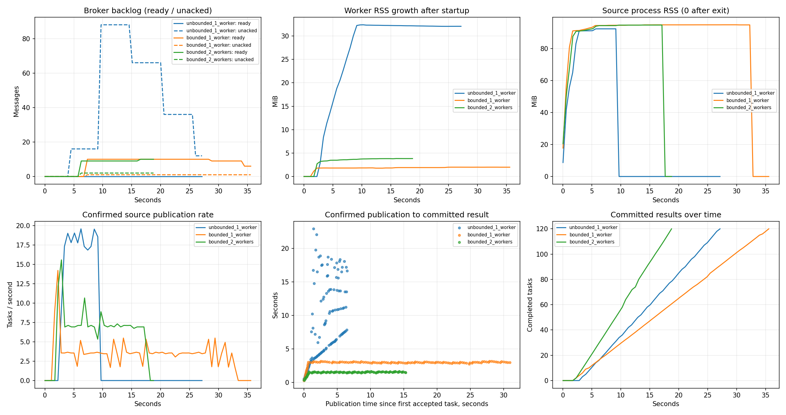
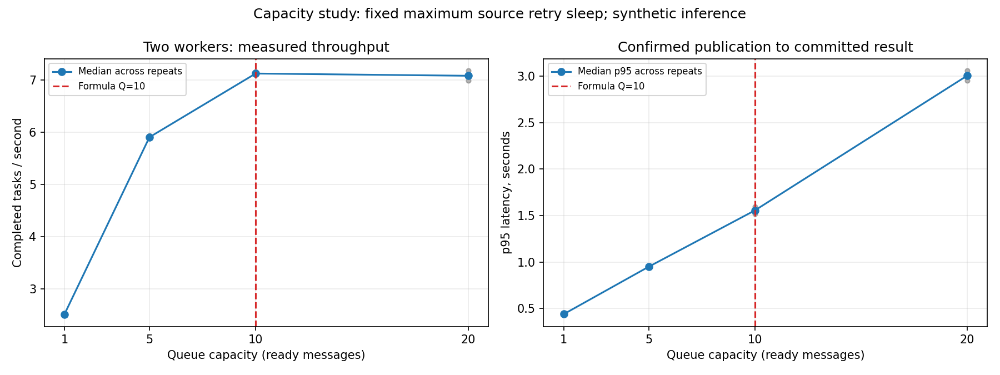

# Исследование противодавления в конвейере обработки задач

Эксперимент проверяет, как ограничение очереди и числа неподтверждённых сообщений влияет на накопление задач, потребление памяти, скорость источника и время получения результата

## Условия эксперимента

- Три конфигурации: один воркер без ограничений, один воркер с ограничениями, два воркера с ограничениями
- В каждом сценарии: 120 задач с одинаковой структурой входных данных
- Каждая задача содержит искусственную историю продаж из 4096 чисел, увеличенный размер сообщения позволяет заметнее измерить потребление памяти
- Воркер загружает тестовую модель из MLflow Model Registry по alias `champion`
- Минимальная искусственная задержка прогнозирования: 200 мс
- Конкурентность каждого воркера: одна задача
- Интервал сбора показателей: 0,5 секунды
- RabbitMQ и PostgreSQL запускаются в отдельных временных контейнерах, источник и воркеры работают отдельными процессами Python

В режиме без ограничений отключены лимит ожидающих сообщений и ограничение prefetch

В ограниченных режимах ёмкость очереди составляет 10 ожидающих сообщений, prefetch каждого воркера равен 1, переполнение отклоняет новую публикацию через `reject-publish`

Измеряемое время задачи: от подтверждённой публикации до сохранения результата в БД, включая ожидание после приёма сообщения в систему

Прирост памяти: увеличение RSS относительно уровня после запуска воркеров и загрузки модели, для двух воркеров учитывается сумма их процессов

## Результаты основного сравнения

| Показатель | Без ограничений, 1 воркер | С ограничениями, 1 воркер | С ограничениями, 2 воркера |
|---|---:|---:|---:|
| Максимум ожидающих сообщений | 0 | 10 | 10 |
| Максимум неподтверждённых сообщений | 88 | 1 | 2 |
| Пиковая память воркеров, МиБ | 315,59 | 285,57 | 571,03 |
| Прирост памяти воркеров после запуска, МиБ | 32,38 | 1,99 | 3,84 |
| Пиковая память источника, МиБ | 92,36 | 94,88 | 94,72 |
| Средняя скорость публикации за время работы источника, задач/с | 18,20 | 3,88 | 7,83 |
| Средняя скорость обработки, задач/с | 4,92 | 3,54 | 7,15 |
| Медиана времени до результата, с | 7,58 | 3,00 | 1,54 |
| p95 времени до результата, с | 18,45 | 3,13 | 1,63 |
| От первой принятой задачи до последнего результата, с | 24,38 | 33,92 | 16,78 |
| Завершено задач | 120 из 120 | 120 из 120 | 120 из 120 |

p95 обозначает время, в которое укладываются 95% принятых задач в соответствующем прогоне

Показатели в динамике:



Исходные измерения: [временные ряды](reports/backpressure/timeseries.csv), [результаты отдельных задач](reports/backpressure/tasks.csv), [сводные показатели](reports/backpressure/summary.json)

## Выводы

1. Без ограничений источник публиковал задачи значительно быстрее, чем воркер успевал их завершать: 18,20 против 4,92 задачи/с, накопление достигло 88 неподтверждённых сообщений

   Нулевой максимум ожидающих сообщений в этом режиме не означает отсутствия перегрузки: при отключённом prefetch сообщения быстро передавались потребителю и оставались неподтверждёнными до завершения обработки

2. Ограничения удержали накопление в заданных пределах: не более 10 ожидающих сообщений и одного неподтверждённого сообщения на воркер

   Прирост памяти одного воркера уменьшился с 32,38 до 1,99 МиБ, пиковая память источника во всех сценариях оставалась в диапазоне 92-95 МиБ

3. В установившемся режиме скорость источника приблизилась к скорости завершения задач

   При одном воркере источник публиковал 3,54 задачи/с, а воркер завершал 3,59 задачи/с на том же временном интервале, при двух воркерах обе скорости составили 7,28 задачи/с

   Средние скорости за всё время работы источника отличаются от установившихся: в начале источник заполняет свободный буфер, а в конце прекращает публикацию раньше завершения последних задач

4. Ограничения уменьшили время нахождения принятых задач в системе: p95 снизился с 18,45 до 3,13 секунды при одном воркере и до 1,63 секунды при двух

   Ожидание источника перед успешной публикацией в этот показатель не входит, поэтому снижение p95 не означает сокращения полного времени обработки файла

5. При одном воркере ограниченный режим имел меньшую общую скорость обработки: 3,54 вместо 4,92 задачи/с

   В этом эксперименте контроль накопления и задержек сопровождался снижением пропускной способности одного воркера, обработка всего принятого пакета заняла 33,92 вместо 24,38 секунды

6. Добавление второго воркера увеличило среднюю скорость обработки с 3,54 до 7,15 задачи/с, примерно в 2,02 раза, источник автоматически увеличил скорость публикации

   Время от первой принятой задачи до последнего результата уменьшилось с 33,92 до 16,78 секунды, при этом суммарная пиковая память воркеров выросла примерно вдвое, поскольку каждый процесс загружает собственный экземпляр модели

7. Во всех трёх сценариях приняты и завершены все 120 задач, в сохранённых результатах число попыток каждой задачи равно 1

## Выбор ёмкости очереди

Размер буфера рассчитан для работы до двух воркеров: запас ожидающих задач должен покрывать максимальную паузу источника перед повторной публикацией

```text
Q = число воркеров * число слотов * ceil(максимальная пауза / минимальное время обработки)
Q = 2 * 1 * ceil(1 / 0,2) = 10 сообщений
```

Минимальная задержка 200 мс ограничивает скорость каждого воркера сверху пятью задачами в секунду, расчёт использует эту границу, а не среднюю измеренную скорость

Для проверки отдельно сравнены ёмкости 1, 5, 10 и 20 сообщений, каждый вариант запускался два раза с двумя воркерами

В этом исследовании после каждого отказа источник ждал полную максимальную секунду, такой стрессовый режим отличается от обычного адаптивного увеличения паузы от 50 мс до 1 секунды

| Ёмкость очереди | Медиана скорости обработки, задач/с | Медиана p95 времени до результата, с |
|---:|---:|---:|
| 1 | 2,51 | 0,44 |
| 5 | 5,91 | 0,95 |
| 10 | 7,13 | 1,56 |
| 20 | 7,08 | 3,01 |

При ёмкостях 1 и 5 источник во время пауз не обеспечивал воркеры достаточным запасом задач, увеличение ёмкости с 10 до 20 в этих замерах практически не изменило скорость, но примерно удвоило p95 времени до результата

Все 960 задач дополнительного исследования завершены, результаты поддерживают выбор 10 для проверенных условий



Исходные данные: [отчёт исследования ёмкости](reports/backpressure/capacity_study.json), [временные ряды](reports/backpressure/capacity_timeseries.csv), [результаты задач](reports/backpressure/capacity_tasks.csv)

## Границы выводов

- Основные три конфигурации запускались по одному разу, для устойчивой оценки разброса нужны повторные прогоны
- Одновременно изменяются ёмкость очереди и prefetch, основное сравнение оценивает их совместное действие
- Использованы искусственные данные и тестовая модель, результаты характеризуют инфраструктуру, а не качество прогнозирования продаж
- Измерена память источника и воркеров, память RabbitMQ и PostgreSQL отдельно не измерялась
- Время до результата не включает ожидание перед успешной публикацией
- Счётчики RabbitMQ Management обновляются с задержкой, дискретные измерения могут пропускать кратковременные пики и показывать ненулевой остаток после фактического завершения задач
- Расчёт ёмкости покрывает намеренную паузу повторной публикации, сетевые задержки и ожидание подтверждения могут увеличить полный интервал реакции
- Выбор ёмкости относится к заданным задержке, масштабу и режиму повторов, при изменении этих параметров требуется повторная проверка

## Воспроизведение

Команды выполняются из корня репозитория при работающем Docker

```powershell
uv run --locked python scripts/benchmark_backpressure.py
uv run --locked python scripts/benchmark_backpressure.py --capacity-study --repeats 2
```
